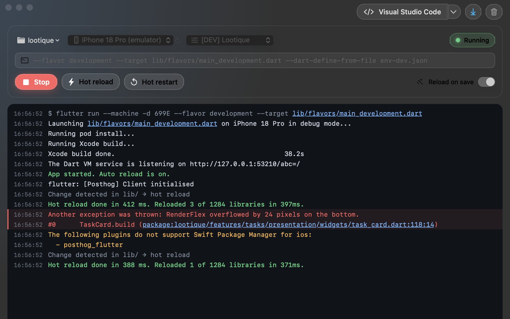
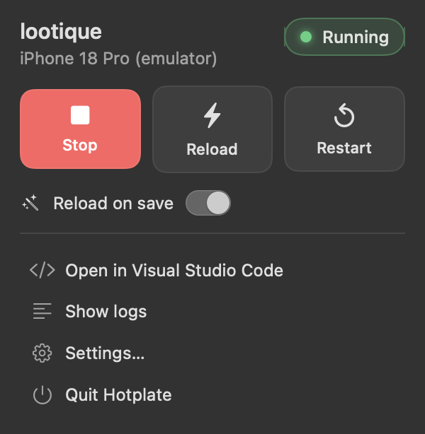

# Hotplate

Keeps your Flutter app hot. A small native macOS app that runs a Flutter project,
hot reloads it whenever you save a `.dart` file, and shows the logs, so you can use
any editor (Zed, Neovim, Sublime, …) without giving up hot reload. It replaces only
the "run + hot reload" part of the VS Code Flutter extension.





**Latest: 1.1.1** — 1.1.0 added the `hotplate` terminal command; 1.1.1 fixes quitting during a stop.
See the [changelog](CHANGELOG.md).

Use it two ways, sharing the same settings:

- **The app**: a window plus a menu bar panel, with global shortcuts so you can reload without leaving your editor.
- **The terminal**: `hotplate` runs the same session in any terminal, driven from the keyboard.

## Install

You need macOS 14 (Sonoma) or newer and the Flutter SDK.

**Homebrew** (installs the app and the `hotplate` command):

```bash
brew install hrvojebencik/tap/hotplate
```

**Or download** `Hotplate-<version>.dmg` from the [latest release](../../releases/latest), drag Hotplate
to Applications and open it. To get the `hotplate` command too, choose **Hotplate → Install Command Line Tool…**
(or Settings → Command line). It links `/usr/local/bin/hotplate` to the tool inside the app, so move the app to
Applications first.

The app is signed with a Developer ID and notarized by Apple.

## Using the app

1. **Open a project**: ⌘O, or pick one from the recent projects menu. Choose the folder with `pubspec.yaml`.
2. **Pick a device** in the toolbar (⌘⇧D refreshes the list). If the project has `.vscode/launch.json`, pick a
   configuration; its arguments fill the args field. Type in that field to pass your own `flutter run` arguments.
3. **Run** with ⌘⏎. Turn on **Reload on save** (⌘⇧A) and every saved `.dart` file under `lib/` triggers a hot reload.
4. **Edit in any editor.** ⌘E opens the project in your editor (choose it in the toolbar or Settings → Editor).
   File references in the log (`lib/main.dart:12`) are links that open the file at that line.

The menu bar icon has the same controls, so you can close the window and keep working. Its icon shows the state:
running, reloading, or failed.

| Shortcut | Action | Shortcut | Action |
|---|---|---|---|
| `⌘⏎` | Run | `⌘O` | Open project |
| `⌘.` | Stop | `⌘E` | Open in editor |
| `⌘R` | Hot reload | `⌘⇧A` | Reload on save on/off |
| `⌘⇧R` | Hot restart | `⌘⇧D` | Refresh devices |
| `⌃⌥R` | Hot reload, from any app | `⌘⇧F` | Follow logs on/off |
| `⌃⌥⇧R` | Hot restart, from any app | `⌘K` | Clear logs |

You can turn the global shortcuts (⌃⌥R, ⌃⌥⇧R) on or off in Settings → Global shortcuts. Settings also has the Flutter
path, the editor (including a custom shell command for terminal editors) and the reload debounce.

## Using the terminal

`hotplate` runs the same session in your terminal, so you never have to switch to the Hotplate window.

```bash
hotplate                      # the Flutter project in this folder (or a parent)
hotplate ~/code/my_app        # a specific project
hotplate -d iphone -c Dev     # device (part of the name is enough) and launch.json configuration
hotplate -- --flavor dev --dart-define=API=staging   # extra flutter run arguments
```

| Option | Meaning |
|---|---|
| `-d, --device <id\|name>` | Device to run on (part of the name is enough) |
| `-c, --config <name>` | Configuration from `.vscode/launch.json` |
| `--no-run` | Open without starting the app |
| `--no-auto-reload` | Don't hot reload on save in this session |
| `--flutter <path>` | Path to the `flutter` executable |
| `-h, --help` / `--version` | Help / version |

Options apply to that run only and never overwrite your saved settings. Choices you make inside hotplate
(device, args, editor) are remembered per project and shared with the app.

| Key | Action | Key | Action |
|---|---|---|---|
| `⏎` | Run / open selected file | `o` `[` `]` | Newest error, previous/next file link |
| `r` / `R` | Hot reload / restart | `/` `n` `N` | Search the log |
| `s` | Stop | `y` / `Y` | Copy line / whole log |
| `q` | Stop and quit | `j` `k` `g` `G` `f` | Scroll, top, bottom, follow |
| `d` / `c` / `a` | Device / configuration / args | `K` | Clear the log |
| `A` | Reload on save on/off | `e` / `E` | Open in editor / choose editor |
| `p` | Recent projects | `?` | All shortcuts |

Click a file link to open it; Shift+drag selects text (Option+drag in iTerm2). Ctrl+C twice kills flutter if it hangs.

## How it works

- `FlutterDaemon` runs `flutter run --machine -d <device> <args>` and speaks its
  JSON protocol (`app.restart`, `app.stop`, `app.started`, `app.log`, …).
- `FileWatcher` (FSEvents) watches `lib/` for `.dart` changes, debounced (300 ms
  by default), and triggers a hot reload while the app is running.
- `DeviceService` runs `flutter devices --machine` for the device picker.
- `LaunchConfigReader` reads `.vscode/launch.json` (comments and trailing commas
  tolerated). Pick a configuration in the toolbar and its `program`, `args`,
  `toolArgs`, `flutterMode` and `deviceId` become the run arguments. Editing the
  args field switches back to "Custom". The file is re-read before every run.
- "Open in Editor" (⌘E) opens the project folder in your editor. Settings → Editor
  lists detected apps (Zed, VS Code, Cursor, Sublime, Android Studio, Xcode, …),
  lets you pick any other .app, or run a custom shell command with `{path}`
  (for terminal editors, e.g. `open -a kitty --args nvim {path}`).
- Dart file references in the log (`package:app/x.dart:12:3`, `lib/main.dart:5`, absolute
  paths) are links: click one to open the file at that line in your editor. Uses the CLI
  bundled with VS Code, Cursor, Windsurf, Zed, Sublime, Xcode, Android Studio, IntelliJ
  (`.dart_tool/package_config.json` resolves other packages). Custom editors get a
  second template with `{file}` and `{line}`.
- Global shortcuts: ⌃⌥R hot reload, ⌃⌥⇧R hot restart from any app (Settings → Global shortcuts).
- Recent projects, the last device and extra args per project are stored in
  UserDefaults.

## Development

### Requirements

- macOS 14 (Sonoma) or newer
- Xcode 15+ command line tools
- Flutter SDK installed

### Build & run from source

```bash
swift build
swift run Hotplate
```

Or open `Package.swift` in Xcode and run the `Hotplate` scheme. The terminal UI: `swift run hotplate-cli`.

### Tests

```bash
swift test
```

### Build the distributable .app

```bash
scripts/build_app.sh
```

Produces `dist/Hotplate.app`, `dist/Hotplate-<version>.zip`, `dist/Hotplate-<version>.dmg`
and `dist/README.txt`.

**Signing.** With no Developer ID certificate the app is ad-hoc signed and recipients must allow it in
System Settings › Privacy & Security. To ship without warnings you need the Apple Developer Program:

1. Create a *Developer ID Application* certificate in Xcode › Settings › Accounts (it lands in your keychain;
   the script finds it automatically, or pass `SIGNING_IDENTITY="Developer ID Application: …"`).
2. Store notarization credentials once:
   `xcrun notarytool store-credentials HotplateNotary --apple-id you@example.com --team-id TEAMID --password <app-specific-password>`
3. Build with `NOTARY_PROFILE=HotplateNotary scripts/build_app.sh`. The script notarizes the DMG, staples
   the ticket to both the DMG and the app, and re-zips.

## Layout

```
Sources/HotplateCore   # protocol, process, watcher, models (unit-tested)
Sources/Hotplate       # SwiftUI app
Sources/HotplateTUI    # terminal UI (unit-tested)
Sources/hotplate-cli   # the `hotplate` command
Tests/HotplateCoreTests
scripts/build_app.sh        # .app + zip
docs/superpowers/           # design spec and implementation plan
```

## Privacy

Hotplate makes no network requests of its own and collects nothing. Everything runs locally:
it launches `flutter`, watches your project folder, and stores its settings in `~/Library/Preferences`.

## Trademarks

Flutter and the related logo are trademarks of Google LLC. Hotplate is not endorsed by or
affiliated with Google LLC.
